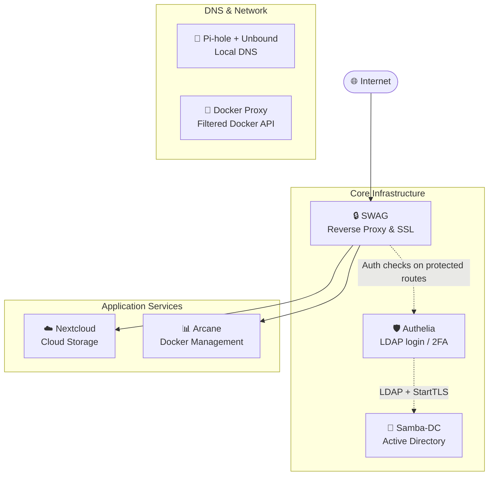

# 🐳 Docker Compose Infrastructure Stack

Docker Compose configurations for a single-host homelab: Active Directory, LDAP-backed authentication, reverse proxy, DNS, monitoring, and applications.

> **This is a curated public extract of a Debian 13 / OpenMediaVault homelab stack, not the complete or necessarily current live configuration.** It includes Compose files and selected supporting configuration and scripts. Credentials, service environment files, runtime data, and some mounted configuration are not included. Treat it as a reference to adapt, not a ready-to-deploy distribution or a high-availability design.

---

## 🤔 Why this stack?

**Why Docker Compose instead of Kubernetes?**
Compose keeps service management straightforward on one host without adding a cluster control plane. I use a separate [Talos Kubernetes cluster](https://github.com/dmuiX/k8s-cluster-talos) for learning and testing; this stack deliberately uses a simpler single-host model. Resource usage depends on the services and workload, and this extract does not provide failover.

**Why Authelia instead of Keycloak?**
Authelia's configuration-driven approach fits the authentication needs here: LDAP-backed login, two-factor authentication, and support for OIDC. SWAG can delegate access checks to Authelia for explicitly protected routes. Application-native OIDC is a separate integration, and its configuration is incomplete in this public extract.

**Why Samba-DC instead of FreeIPA or LDAP-only?**
Samba-DC provides AD-compatible DNS, Kerberos, LDAP, domain join, and Group Policy capabilities. That supports centralized accounts and group management for domain clients as well as Authelia's LDAP backend. FreeIPA did not fit my Docker setup when tested; an LDAP-only directory would not provide Windows domain join and Group Policy. Client enrollment and Kerberos-based application SSO are not configured by this repository.

**Why Uptime Kuma instead of Prometheus/Grafana?**
Uptime Kuma, included in the SWAG Compose file, provides endpoint monitoring without a metrics database and exporters. For this host, OMV and tools such as `btop` cover system statistics. Host-level email alerting and BorgBackup are managed separately through OpenMediaVault; their configuration is not published here.

---

## 🏗️ Architecture Overview



---

## 📦 Services

| Folder | Service | Description |
| ------ | ------- | ----------- |
| [`1-swag/`](1-swag/) | **SWAG** | Reverse proxy with automatic SSL (Let's Encrypt) |
| [`authelia/`](authelia/) | **Authelia** | LDAP-backed authentication and 2FA; OIDC setup is incomplete |
| [`samba-dc/`](samba-dc/) | **Samba DC** | Active Directory domain controller |
| [`pihole/`](pihole/) | **Pi-hole** | DNS server with ad-blocking (+ Unbound) |
| [`dockerproxy/`](dockerproxy/) | **Docker Proxy** | Filtered Docker API access for trusted management services |
| [`arcane/`](arcane/) | **Arcane** | Docker management UI and project overview |
| [`nextcloud/`](nextcloud/) | **Nextcloud** | Self-hosted cloud storage — initial setup via browser on first start |

---

## 🔐 Auth Layer (Samba-DC + Authelia)

Samba-DC provides the **Active Directory / LDAP** directory. The published [Authelia configuration](authelia/config/configuration.yml) uses the `activedirectory` backend over LDAP with **StartTLS and certificate verification**, a dedicated service-account DN, and a two-factor access policy.

Reverse-proxy authentication applies only where SWAG is configured to call Authelia; proxying a service does not automatically enable SSO or application-level user provisioning. The Uptime Kuma labels explicitly request Authelia protection. Nextcloud's published Compose file does not configure an LDAP or OIDC connector, and Arcane includes OIDC group/account settings but not a complete provider configuration.

**OIDC is not ready to use in the published configuration.** The `identity_providers.oidc` section is empty; signing keys and client registrations must be supplied. The Compose file references an OIDC HMAC secret, but that alone does not configure a provider.

### 🌐 DNS Records

The file [`samba-dc/dns-records`](samba-dc/dns-records) contains DNS entries for your domain (e.g. `domain.org`).

Review the domain and addresses before using [`samba-dc/import-dns-records.sh`](samba-dc/import-dns-records.sh). It updates the running domain controller and replaces conflicting records for the same host/type.

[`authelia/add-client.sh`](authelia/add-client.sh) is a host-specific helper, not a bootstrap command: it has a hardcoded configuration path, expects an existing `clients:` list, prints a generated client secret, and restarts Authelia. Review and adapt it only after completing the provider configuration.

### 🔑 Authelia Secrets

Authelia loads secrets from files in `authelia/secrets/` (gitignored — create them on each host).

| Secret file | Purpose |
| --- | --- |
| `AUTHELIA_PASSWORD` | Existing password of the dedicated Authelia LDAP service account |
| `ENCRYPTION_SECRET` | Persistent storage encryption key |
| `JWT_SECRET` | Password-reset JWT signing secret |
| `SESSION_SECRET` | Session secret |
| `oidc/HMAC_SECRET` | OIDC HMAC secret; signing keys and clients are also required |

For a **new installation only**, generate local application secrets from the repository root. Do not overwrite existing secrets, especially the storage encryption key:

```bash
umask 077
mkdir -p authelia/secrets/oidc
openssl rand -base64 48 > authelia/secrets/ENCRYPTION_SECRET
openssl rand -base64 48 > authelia/secrets/JWT_SECRET
openssl rand -base64 48 > authelia/secrets/SESSION_SECRET
openssl rand -base64 48 > authelia/secrets/oidc/HMAC_SECRET
```

Create `authelia/secrets/AUTHELIA_PASSWORD` securely with the password assigned to your LDAP service account; generating a file does not create or update that AD account. Check secret requirements for the Authelia version you deploy. The published notifier writes to `/config/notification.txt`, not SMTP, so no email password is referenced. Restrict access to secrets and notification files while allowing the container to read them.

> **Note:** [`authelia/config/configuration.yml`](authelia/config/configuration.yml) is an example configuration.
> Adjust `domain.org`, the LDAP DNs, NTP endpoint, and access/session policies to match your setup. Ensure the LDAP certificate chain is trusted; do not bypass verification to work around missing TLS setup.

See [`authelia/authelia.yml`](authelia/authelia.yml) for the expected secret paths.

---

## 🏢 Samba DC

Samba-DC runs on **macvlan** with a dedicated LAN IP. Its health check probes ports 53, 389, 445, and 636; this is not a complete AD firewall port list. Keep directory services on trusted networks, not exposed to the Internet.

The domain admin password is passed as a Docker secret — create the file before starting:

```bash
# New installation only: do not overwrite an existing domain password file.
umask 077
openssl rand -base64 32 > samba-dc/samba_admin_pass
```

> Create `samba-dc/samba_admin_pass` locally and keep it out of Git. Set `ADMIN_PASSWORD_SECRET=samba_admin_pass` in your private service environment file so the image reads the mounted Docker secret. Changing the file alone does not rotate an existing domain's administrator password.

The Compose file mounts SWAG's certificate directory, and Samba's TLS settings reference files under `/etc/samba/tls/`. Certificate provisioning and renewal plumbing are not fully included. Confirm working LDAP TLS before starting Authelia.

---

## 🔒 Reverse Proxy (SWAG)

SWAG publishes HTTP/HTTPS on ports 80/443, obtains certificates through Cloudflare DNS validation, and proxies configured services. This does not protect direct LAN access to other services.

The Compose file mounts local `1-swag/config/`, `1-swag/custom-proxies/`, `1-swag/custom-cont-init.d/`, and `1-swag/rdap-dns.json`, among other paths. Their contents are not included in this extract; supply or adapt them before deployment. Do not assume that mounting a directory enables the required proxy/authentication configuration.

Create `1-swag/cloudflare.ini` locally with restricted permissions and keep it out of Git. The published `.gitignore` does not explicitly exclude this file or `samba-dc/samba_admin_pass`; ensure both are ignored locally before adding credentials.

```ini
# Placeholder only: use a token scoped to the required zone and DNS permissions.
dns_cloudflare_api_token = YOUR_CLOUDFLARE_API_TOKEN
```

---

## 🧹 DNS (Pi-hole + Unbound)

Pi-hole (`jacklul/pihole:dev`) provides local DNS and ad-blocking on a dedicated macvlan LAN IP. Unbound (`madnuttah/unbound:latest`) runs alongside it on the shared `pihole` network; no custom Unbound configuration is included. Configure `FTLCONF_dns_upstreams` for the intended resolver and verify the image's listening port rather than assuming the health-check port is the DNS port.

[`pihole/05-samba-dc.conf`](pihole/05-samba-dc.conf) forwards the AD domain to Samba-DC, but its address differs from the one in `samba-dc.yml`. Reconcile this with the static LAN addresses, DNS forwarder, domain, and reverse-DNS settings before use.

---

## 🔌 Docker API Access

The [socket proxy](dockerproxy/dockerproxy.yml) exposes a filtered Docker API on the `dockerproxy` network without a published host port. It enables `POST` and container/image/volume endpoints, so it is **not a read-only security boundary**, even though the socket mount is marked `:ro`. Only trusted services should join this network; never expose port 2375 publicly. Arcane also mounts a host Compose-project directory with write access: review and adapt that host-specific path.

---

## ⚙️ Environment Variables

Several services rely on the following variables being present in the shell environment:

| Variable | Description | Example |
| --- | --- | --- |
| `TZ` | Timezone | `Europe/Berlin` |
| `PUID` | User ID for file permissions | `1000` |
| `PGID` | Group ID for file permissions | `1000` |

In the original setup these are injected globally by **OpenMediaVault**. Outside OMV, export suitable values in the shell used to run Compose:

```bash
export TZ=Europe/Berlin
export PUID=1000
export PGID=1000
```

These are example values. UID/GID variable support depends on the image; their presence does not guarantee identical permission handling across services.

No environment-file templates are included. Create the exact files referenced by each `env_file` entry locally and keep all credentials out of Git:

| Compose file | Private environment file | Configuration to supply or review |
| --- | --- | --- |
| `1-swag/1-swag.yml` | `1-swag/1-swag.env` | `EMAIL`, `URL`, and Cloudflare credentials in the separate INI file |
| `authelia/authelia.yml` | `authelia/authelia.env` | Additional local settings; secret files are mounted separately |
| `samba-dc/samba-dc.yml` | `samba-dc/samba-dc.env` | `DOMAIN_TITLE`, `REALM`, `DNS_FORWARDER`, `ADMIN_PASSWORD_SECRET` |
| `pihole/pihole.yml` | `pihole/pihole.env` | `FTLCONF_webserver_port`, `FTLCONF_webserver_domain`, `FTLCONF_dns_revServers`, `FTLCONF_dns_upstreams`, `HOSTNAME` |
| `arcane/arcane.yml` | `arcane/arcane.env` | `APP_URL`, `ENCRYPTION_KEY`, `JWT_SECRET`, and any application OIDC settings |
| `nextcloud/nextcloud.yml` | `nextcloud/nextcloud.env` | `NEXTCLOUD_TRUSTED_DOMAINS`, Redis settings, and PostgreSQL credentials/database settings |

A service's `env_file` populates the container environment; it does **not** by itself supply Compose's `${...}` interpolation. Export those values or pass the same private file using `--env-file` when running Compose. See the startup example below. The socket proxy has no `env_file` entry and uses the exported globals.

---

## 🌐 Docker Networks

The shared networks `swag`, `dockerproxy`, `pihole`, and `macvlan0` are **external** and must exist before starting the relevant projects. Nextcloud's private `nextcloud` network is created by Compose.

Example network setup (set `LAN_SUBNET`, `LAN_GATEWAY`, and `LAN_INTERFACE` to your own values first):

```bash
docker network create swag
docker network create dockerproxy
docker network create pihole
docker network create -d macvlan \
  --subnet="${LAN_SUBNET}" \
  --gateway="${LAN_GATEWAY}" \
  -o parent="${LAN_INTERFACE}" \
  macvlan0
```

> Both Samba-DC and Pi-hole use `macvlan0`. Match their static addresses to your chosen subnet and avoid address conflicts. Macvlan normally prevents direct host-to-container communication; plan host DNS and any required host access accordingly. The shared `swag` bridge is connectivity, not per-application isolation.

---

## 🛡️ Container Registry (`dhi.io`)

The published files use a mix of registries, including [Docker Hardened Images](https://dhi.io):

| Image | Used by |
| --- | --- |
| `dhi.io/uptime-kuma:2` | SWAG's monitoring service |
| `dhi.io/postgres:18-alpine3.22` | Nextcloud database |
| `dhi.io/redis:8` | Nextcloud cache |

Check registry access requirements before pulling. Alternative upstream images include `louislam/uptime-kuma`, `postgres`, and `redis`, but they are not guaranteed drop-in replacements: verify tags, user permissions, data paths, commands, and health checks before switching. Several other published services use `latest` or `dev` tags; review versions and upgrade procedures for your deployment.

---

## 💾 Backups

BorgBackup is managed at the host level through OpenMediaVault, outside this repository. No backup schedule or restore procedure is included here. Plan application-consistent backups of databases, domain state, persistent volumes, configuration, and secrets, and verify recovery before relying on the deployment.

---

## 🚀 Getting Started

1. Clone the repository and review the Compose files for the services you want. Each folder is an independent Compose project; there is no root-level stack file.
2. Adapt domains, static addresses, host paths, and image versions. Supply missing mounted files/directories and private environment files; there are no `*.env` templates to copy.
3. Create the external networks and required secret files. Confirm permissions and protect credentials locally; do not assume every sensitive path is covered by `.gitignore`.
4. Start the Docker socket proxy before services that use it. Bring up DNS and Samba-DC with working upstream resolution. Bootstrap SWAG certificates and Samba LDAP TLS before starting Authelia; this extract does not automate that dependency chain.
5. Complete Authelia's provider/proxy configuration and any application-specific integrations, then start the remaining projects. Review actual authentication and direct-access paths before opening access beyond trusted networks.

For example, after preparing SWAG's prerequisites, run from the repository root:

```bash
docker compose --env-file 1-swag/1-swag.env -f 1-swag/1-swag.yml config --quiet
docker compose --env-file 1-swag/1-swag.env -f 1-swag/1-swag.yml up -d
```

Use the corresponding file pair for each service and retain the exported OMV-style globals. Validate each configuration before starting it; successful parsing alone does not verify DNS, certificates, authentication, or recovery.
